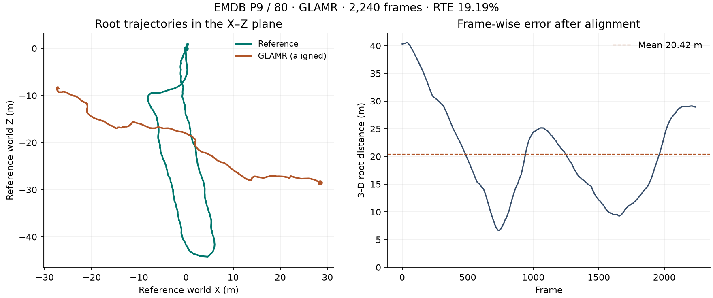

# GLAMR · 单段骨盆轨迹评测

[评测目录](../README.md) · [评分脚本](evaluate.py) · [参考结果](result.json) · [综述首页](../../README.md)

> 用 EMDB 的一段室外步行序列，测量 GLAMR 预测的骨盆轨迹与参考轨迹相差多远。全部 **2,240 帧**对齐后，平均距离为 **20.42 m**，根轨迹误差（RTE）为 **19.19%**。

## 一、数据与准备

| 输入 | 本例使用的内容 |
| --- | --- |
| 实拍序列 | EMDB 的 `P9/80_outdoor_walk_big_circle`，人物 0，第 0 至 2,239 帧 |
| 参考轨迹 | EMDB 样本中的三维骨盆位置 `gt[0].root_trans` |
| 预测轨迹 | 同一文件中 GLAMR 已生成的世界坐标 `person_data[0].root_trans_world` |

只需 CPU、Python 3 和 NumPy。首次运行时，脚本会下载指定版本的样本（约 12.4 MB），再用 SHA-256 检查文件。也可以提前下载，保存为 `P9_80_seed1.pkl`。[下载样本](https://raw.githubusercontent.com/eth-ait/emdb/9a4eab677181a3789bda7ba5c36ab8cff797380c/assets/GLAMR/P9_80_seed1.pkl) · [EMDB 官方示例](https://github.com/eth-ait/emdb/tree/9a4eab677181a3789bda7ba5c36ab8cff797380c#visualize-glamr) · [样本许可](https://github.com/eth-ait/emdb/blob/9a4eab677181a3789bda7ba5c36ab8cff797380c/assets/GLAMR/LICENSE.txt)

## 二、运行评测

### 1. 进入示例目录

在 Linux 或 macOS 上，从仓库根目录打开终端并创建 Python 环境。后续命令都在这个示例目录内运行。

```bash
cd evaluation/emdb_glamr_rte
mkdir -p runs
python3 -m venv .venv
source .venv/bin/activate
python -m pip install numpy
```

### 2. 计算轨迹误差

```bash
python evaluate.py --output runs/result.json
```

终端会打印评分，完整结果同时写入 `runs/result.json`。可以将其中的 `rte_percent` 与本页的[参考结果](result.json)对照。

<details>
<summary>使用本地样本并绘制轨迹图</summary>

将下载的 `P9_80_seed1.pkl` 放到当前示例目录。绘图另外需要 Matplotlib，依赖装好后即可离线运行。

```bash
python -m pip install matplotlib
python evaluate.py --input P9_80_seed1.pkl --output runs/result.json --plot runs/trajectories.png
```

</details>

## 三、结果解读

| 输出字段 | 含义 | 本例结果 |
| --- | --- | ---: |
| `reference_path_length_m` | 参考骨盆在相邻帧间移动的距离之和 | 106.3839 m |
| `mean_aligned_root_distance_m` | 对齐后，预测与参考骨盆逐帧三维距离的均值 | 20.4173 m |
| `rte_percent` | 平均距离占参考轨迹总长度的百分比 | **19.1920%** |

脚本对整段预测轨迹统一做一次旋转和平移，尺度固定为 1。用本例的数值计算，RTE = 20.4173 ÷ 106.3839 × 100% ≈ **19.19%**。这个分数只对应上述序列。复核 EMDB2 全测试集的成绩时，还需按该基准选择序列、有效帧和参考平移量。[EMDB 读取程序](https://github.com/eth-ait/emdb/blob/9a4eab677181a3789bda7ba5c36ab8cff797380c/visualize_GLAMR.py) · [完整评测入口](https://github.com/yohanshin/WHAM/blob/2b54f7797391c94876848b905ed875b154c4a295/lib/eval/evaluate_emdb.py)



左图的圆点表示各自的起点。右图的虚线标出平均距离 **20.42 m**，可以据此找到偏差较大的帧。

<details>
<summary>查看独立核验与项目来源</summary>

对同一输入，WHAM 原版 `compute_rte`（PyTorch 2.6.0，float32）得到 19.192026%，本例脚本（NumPy，float64）得到 19.192046%，相差约 0.000020 个百分点。[WHAM 的 RTE 实现](https://github.com/yohanshin/WHAM/blob/2b54f7797391c94876848b905ed875b154c4a295/lib/eval/eval_utils.py#L464-L482) · [EMDB 数据项目](https://eth-ait.github.io/emdb/) · [GLAMR 模型项目](https://github.com/NVlabs/GLAMR)

</details>
